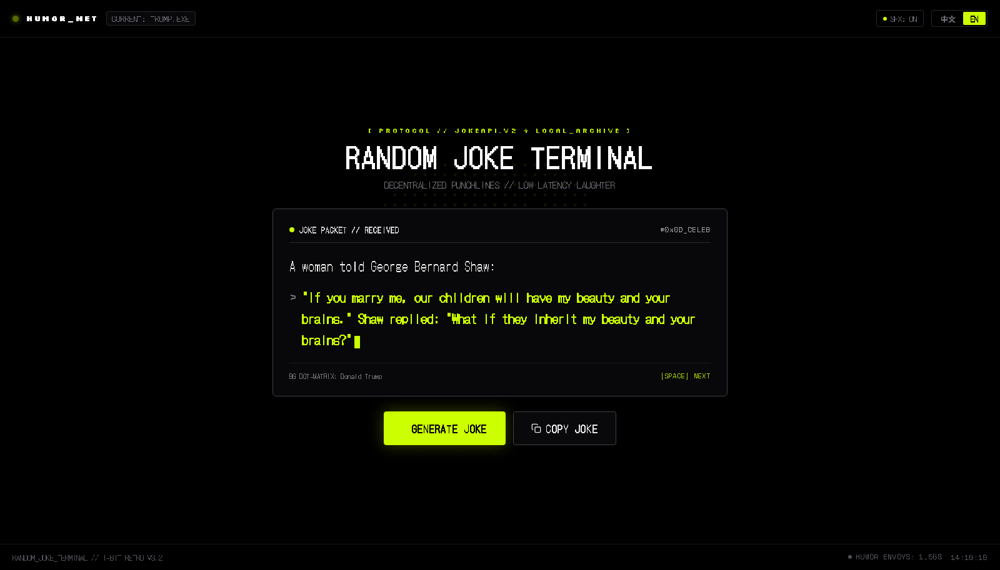

# HUMOR_NET — Random Joke Terminal / 随机笑话终端

A retro terminal-style random joke machine with a bilingual interface, a curated local humor archive, and optional visitor statistics.

一个复古终端风格的双语随机笑话机，内置精选幽默库，并提供可选的访客统计。

**Live demo / 在线体验:** https://sulongwooo.github.io/humor_net/

## Preview / 界面预览

### English UI / 英文界面



### 中文界面 / Chinese UI


## Features / 功能

| English | 中文 |
| --- | --- |
| **Two joke sources** — 70% JokeAPI and 30% curated local archive. | **两种笑话来源** — 70% 来自 JokeAPI，30% 来自本地精选库。 |
| **Curated bilingual archive** — 20 hand-picked entries: 11 cold jokes and 9 celebrity anecdotes, written in both Chinese and English. | **中英双语精选库** — 20 条手工挑选内容：11 条冷笑话和 9 条名人幽默，均提供中英文版本。 |
| **No machine translation for local jokes** — curated entries read naturally in either language. | **本地笑话不经过机翻** — 精选内容的中英文都经过人工整理。 |
| **Chinese mode for API jokes** — JokeAPI content is translated on demand, with a MyMemory fallback. | **API 笑话支持中文** — JokeAPI 内容按需翻译，主接口失败时使用 MyMemory 回退。 |
| **Retro terminal UI** — dot-matrix portrait, typewriter reveal, scanline background, and optional sound effects. | **复古终端界面** — 点阵头像、打字机式显现、扫描线背景，以及可选音效。 |
| **Copy with attribution** — copied jokes include the source and packet ID, e.g. `[via LOCAL_ARCHIVE // #0x0D_CELEB]`. | **复制带来源** — 复制内容会附带来源和编号，例如 `[via LOCAL_ARCHIVE // #0x0D_CELEB]`。 |
| **Hidden theme shortcut** — press `F` to switch dark / light themes; no extra button is shown. | **隐藏主题快捷键** — 按 `F` 切换深浅色，页面上不显示额外按钮。 |
| **No build step** — plain HTML, CSS, and JavaScript. | **无需构建** — 使用原生 HTML、CSS 和 JavaScript。 |
| **Optional local server** — `server.js` adds deduplicated visitor statistics. No npm dependencies. | **可选本地服务** — `server.js` 提供去重访客统计，无 npm 依赖。 |

## Joke Sources / 笑话来源

| English | 中文 |
| --- | --- |
| **JokeAPI v2 — 70%** — Default English pool, about 319 usable English jokes. Translated on demand in Chinese mode. | **JokeAPI v2 — 70%** — 默认英文池约 319 条可用英文笑话，中文模式下按需翻译。 |
| **Local archive — 30%** — 20 entries: 11 cold jokes and 9 celebrity anecdotes, natively bilingual. | **本地精选库 — 30%** — 20 条内容：11 条冷笑话和 9 条名人幽默，原生中英双语。 |

For context, JokeAPI reports 1,368 jokes across all supported languages, but the default English pool is about 319. The site requests the English `Any` endpoint.

补充说明：JokeAPI 官方统计全语言共 1,368 条，但默认英文池约 319 条；本站请求的是英文 `Any` 接口。

The packet ID reveals the source type / 编号可以看出内容来源：

- `#0x0A_COLD` — curated cold joke / 本地冷笑话
- `#0x0D_CELEB` — curated celebrity anecdote / 本地名人幽默
- `#0xD7_PUN` — JokeAPI category, in this case a pun / JokeAPI 分类，此处为双关

## Quick Start / 快速开始

### Static mode / 静态模式

```bash
git clone https://github.com/sulongwooo/humor_net.git
cd humor_net
open index.html
```

Any static file server also works / 也可以使用任意静态服务器：

```bash
python3 -m http.server 8080
```

Open <http://localhost:8080> / 打开 <http://localhost:8080>。

Static mode supports browsing, copying, theming, and language switching. Visitor counts fall back to a per-browser local record because there is no backend.

静态模式支持浏览、复制、主题切换和中英文切换；由于没有后端，访客数会回退为当前浏览器本地记录。

### Full local mode with visitor stats / 带访客统计的完整本地模式

Requires Node.js 18 or newer / 需要 Node.js 18 或更高版本：

```bash
node server.js
```

Open <http://localhost:8000> / 打开 <http://localhost:8000>。

The Node server adds / Node 服务提供：

- A visitor cookie (`humor_net_visitor`) that deduplicates visits for 24 hours. / 访客 Cookie（`humor_net_visitor`），24 小时内不重复计数。
- A disk log at `.visits.json` (gitignored). / 本地记录文件 `.visits.json`（已被 Git 忽略）。
- A displayed count starting at 1,566 (base 1,565 plus the first visitor). / 显示数从 1,566 开始（基础值 1,565 加第一位访客）。

Delete `.visits.json` and restart the server to reset local statistics.

删除 `.visits.json` 后重启服务，即可重置本地统计。

## How It Works / 工作原理

1. **Pick a joke / 选择笑话** — On load or when you press `Space`, the app picks a joke. / 页面加载或按 `Space` 时，应用会随机选择一条笑话。
2. **Route by ratio / 按比例分流** — A random draw sends 70% of requests to JokeAPI and 30% to the local archive. / 按 70% JokeAPI、30% 本地库的比例随机分流。
3. **Translate only when needed / 按需翻译** — JokeAPI responses keep English setup and punchline; Chinese mode translates and caches them for the current joke. / JokeAPI 内容保留英文原文；中文模式按需翻译并缓存当前笑话。
4. **Use native local copy / 本地内容直接读取** — Local entries already contain Chinese and English versions, avoiding translation drift. / 本地条目的中英文版本直接读取，避免机翻偏差。
5. **Render into the terminal / 终端式呈现** — The joke is revealed character by character, followed by its source and packet ID. / 笑话逐字显示，并附上来源和编号。

## Visitor Stats / 访客统计

The status bar can show cumulative visitors, but behavior depends on where the site runs.

状态栏可以显示累计访客，但具体行为取决于运行方式。

- **Node server / Node 服务** — Real aggregated counts from the local visit log, deduplicated per browser for 24 hours. / 基于本地访问日志的真实累计，同一浏览器 24 小时内只计一次。
- **GitHub Pages / static hosting / GitHub Pages 或静态托管** — `/api/visit` is unavailable, so the badge falls back to `base value + local visit days` on each browser. This is a local record, not a global total. / `/api/visit` 不可用，徽章回退为“基础值 + 本机到访天数”。这是本机记录，不是全局总人数。

This limitation is intentional and visible: the page never pretends that a static-hosted counter is a global audience measurement.

这个限制是刻意保留且可见的：页面不会把静态托管的计数伪装成全局访问量。

## Keyboard Shortcuts / 快捷键

| Key / 按键 | Action / 作用 |
| --- | --- |
| `Space` | Load another joke / 换一个笑话 |
| `F` | Toggle dark / light theme (hidden shortcut) / 切换深色与浅色（隐藏快捷键） |

Language and sound can be switched from the top-right controls.

语言和音效可以在右上角控件中切换。

## Project Structure / 项目结构

```text
humor_net/
├── index.html                 # Page structure / 页面结构
├── style.css                  # Terminal themes and layout / 终端主题与布局
├── script.js                  # Jokes, translation, rendering, stats / 笑话、翻译、渲染与统计
├── i18n.js                    # Interface copy / 中英文界面文案
├── server.js                  # Optional stats server / 可选统计服务
├── assets/
│   ├── preview-en.png         # English UI preview / 英文界面预览
│   └── preview-zh.png         # Chinese UI preview / 中文界面预览
├── GETTING_STARTED.md         # Local setup / 本地运行指南
├── GITHUB_PAGES_SETUP.md      # Pages deployment / Pages 部署说明
├── OPEN_WEBSITE.md            # Ways to open the site / 打开方式
├── CONTRIBUTING.md
├── CODE_OF_CONDUCT.md
├── SECURITY.md
├── ISSUE_TEMPLATE.md
└── LICENSE
```

## Tech Stack / 技术栈

- HTML5, CSS3, and ES6+ JavaScript / HTML5、CSS3 和 ES6+ JavaScript
- Canvas for the dot-matrix portrait / Canvas 绘制点阵头像
- [JokeAPI v2](https://jokeapi.dev/) for the external joke pool / 外部笑话源
- Google Translate's public endpoint for Chinese translation, with MyMemory as a fallback / 中文翻译主接口，MyMemory 作为回退
- Node.js built-in modules only (`http`, `fs`, `path`, `crypto`) for the optional stats server / 可选统计服务仅使用 Node 内置模块

## Documentation / 文档

- [Getting Started / 本地运行](GETTING_STARTED.md)
- [GitHub Pages Setup / Pages 部署](GITHUB_PAGES_SETUP.md)
- [Open the Website / 打开方式](OPEN_WEBSITE.md)
- [Contributing / 贡献指南](CONTRIBUTING.md)

## Contributing / 贡献

Issues and pull requests are welcome. For larger changes, open an issue first so the approach can be discussed.

欢迎提交 Issue 和 Pull Request。较大的改动建议先开 Issue 讨论方向。

1. Fork the repository. / Fork 仓库。
2. Create a feature branch. / 创建功能分支。
3. Make and test your change. / 完成并测试改动。
4. Open a pull request with a short description. / 提交 Pull Request 并附简短说明。

## Future Ideas / 后续想法

- Category switch for the local archive: all / cold jokes / celebrity humor. / 本地库分类切换：全部 / 冷笑话 / 名人幽默。
- Joke history and favorites. / 笑话历史与收藏。
- Offline cache for JokeAPI so the app can keep working when the API is unavailable. / 为 JokeAPI 增加离线缓存，接口不可用时仍能使用。

## License / 许可证

MIT License. See [LICENSE](LICENSE).

MIT 许可证，详见 [LICENSE](LICENSE)。

---

Created by [sulongwooo](https://github.com/sulongwooo).

作者：[sulongwooo](https://github.com/sulongwooo)。
