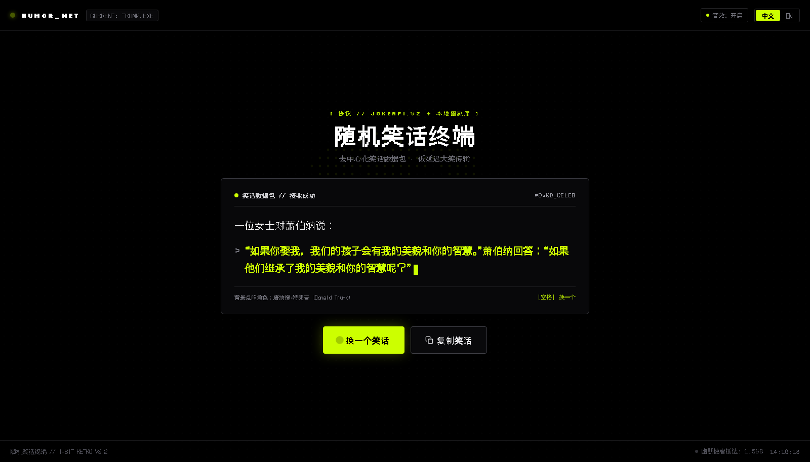

# HUMOR_NET — Random Joke Terminal

A retro terminal-style random joke machine with a bilingual interface, a curated local humor archive, and optional visitor statistics.

**Live demo:** https://sulongwooo.github.io/humor_net/

## Preview

### English UI


### Chinese UI



## Features

- **Two joke sources** — 70% JokeAPI / 30% curated local archive.
- **Curated bilingual archive** — 20 hand-picked entries: 11 cold jokes and 9 celebrity humor anecdotes, each written in both Chinese and English.
- **No machine translation for local jokes** — the curated archive reads naturally in either language.
- **Chinese mode for API jokes** — JokeAPI content is translated on demand, with a MyMemory fallback if the primary translation endpoint fails.
- **Retro terminal UI** — dot-matrix portrait, typewriter reveal, scanline background, and optional sound effects.
- **Copy with attribution** — copied jokes include the source and packet ID, e.g. `[via LOCAL_ARCHIVE // #0x0D_CELEB]`.
- **Hidden theme shortcut** — press `F` to switch between dark and light themes; no extra button is shown.
- **No build step** — plain HTML, CSS, and JavaScript.
- **Optional local server** — `server.js` adds cookie-based, deduplicated visitor statistics. No npm dependencies.

## Joke Sources

| Source | Share | Pool | Language handling |
| --- | --- | --- | --- |
| JokeAPI v2 | 70% | Default English pool, about 319 usable English jokes | Translated on demand in Chinese mode |
| Local archive | 30% | 20 entries: 11 cold jokes + 9 celebrity anecdotes | Native Chinese and English |

For context, JokeAPI reports 1,368 jokes across all supported languages, but the default English pool is about 319. The site requests the English `Any` endpoint.

The packet ID reveals the source type:

- `#0x0A_COLD` — curated cold joke
- `#0x0D_CELEB` — curated celebrity anecdote
- `#0xD7_PUN` — JokeAPI category, in this case a pun

## Quick Start

### Static mode

```bash
git clone https://github.com/sulongwooo/humor_net.git
cd humor_net
open index.html
```

Or serve it with any static file server:

```bash
python3 -m http.server 8080
```

Then open <http://localhost:8080>.

Static mode works for browsing jokes, copying, theming, and language switching. Visitor counts fall back to a per-browser local record because there is no backend.

### Full local mode with visitor stats

Requires Node.js 18 or newer.

```bash
node server.js
```

Open <http://localhost:8000>.

The Node server adds:

- A visitor cookie (`humor_net_visitor`) that deduplicates visits for 24 hours.
- A disk log at `.visits.json` (gitignored).
- A displayed count that starts at 1,566 (base value 1,565 plus the first visitor).

Delete `.visits.json` and restart the server to reset local statistics.

## How It Works

1. On load or when you press `Space`, the app picks a joke.
2. A random draw sends 70% of requests to JokeAPI and 30% to the local archive.
3. JokeAPI responses keep their English setup and punchline. In Chinese mode, both parts are translated and cached for the current joke.
4. Local archive entries already contain Chinese and English versions, so switching languages is instant and avoids translation drift.
5. The joke is rendered character by character into the terminal card, then the source and packet ID are shown.

## Visitor Stats

The status bar can show cumulative visitors, but its behavior depends on where the site runs:

- **Node server (`node server.js`)** — real aggregated counts from the local visit log, deduplicated per browser for 24 hours.
- **GitHub Pages / static hosting** — `/api/visit` is unavailable, so the badge falls back to `base value + local visit days` on each browser. This is a local record, not a global total.

This limitation is intentional and visible: the page never pretends that a static-hosted counter is a global audience measurement.

## Keyboard Shortcuts

| Key | Action |
| --- | --- |
| `Space` | Load another joke |
| `F` | Toggle dark / light theme (hidden shortcut) |

Language and sound can be switched from the top-right controls.

## Project Structure

```text
humor_net/
├── index.html                 # Page structure and terminal layout
├── style.css                  # Terminal theme, light theme, responsive layout
├── script.js                  # Joke sources, translation, rendering, stats, shortcuts
├── i18n.js                    # Chinese/English interface copy
├── server.js                  # Optional Node server with visitor statistics
├── assets/
│   ├── preview-en.png         # English UI preview
│   └── preview-zh.png         # Chinese UI preview
├── GETTING_STARTED.md         # Detailed local setup
├── GITHUB_PAGES_SETUP.md      # GitHub Pages deployment notes
├── OPEN_WEBSITE.md            # Ways to open the site
├── CONTRIBUTING.md
├── CODE_OF_CONDUCT.md
├── SECURITY.md
├── ISSUE_TEMPLATE.md
└── LICENSE
```

## Tech Stack

- HTML5, CSS3, and ES6+ JavaScript.
- Canvas for the dot-matrix portrait.
- [JokeAPI v2](https://jokeapi.dev/) for the external joke pool.
- Google Translate's public endpoint for Chinese translation, with MyMemory as a fallback.
- Node.js built-in modules only (`http`, `fs`, `path`, `crypto`) for the optional stats server.

## Documentation

- [Getting Started](GETTING_STARTED.md)
- [GitHub Pages Setup](GITHUB_PAGES_SETUP.md)
- [Open the Website](OPEN_WEBSITE.md)
- [Contributing](CONTRIBUTING.md)

## Contributing

Issues and pull requests are welcome. For larger changes, open an issue first so the approach can be discussed.

1. Fork the repository.
2. Create a feature branch.
3. Make and test your change.
4. Open a pull request with a short description.

## Future Ideas

- Category switch for the local archive: all / cold jokes / celebrity humor.
- Joke history and favorites.
- Offline cache for JokeAPI so the app can keep working when the API is unavailable.

## License

MIT License. See [LICENSE](LICENSE).

---

Created by [sulongwooo](https://github.com/sulongwooo).
